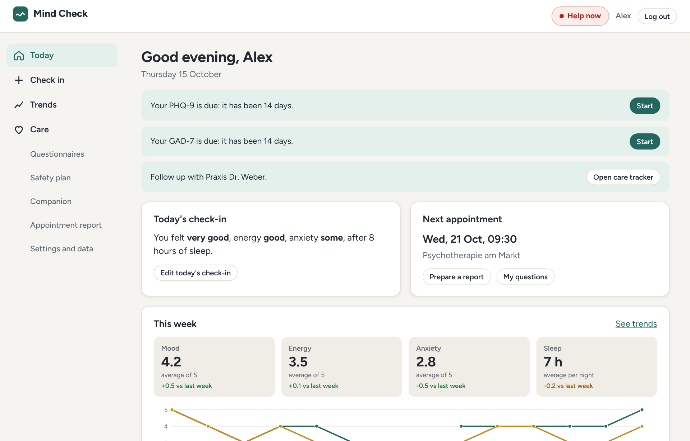
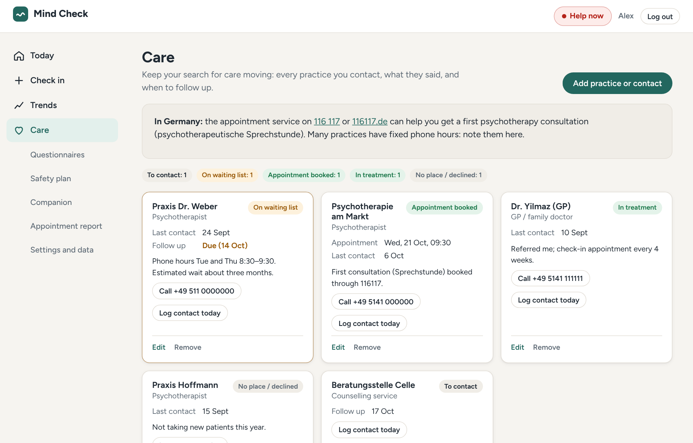
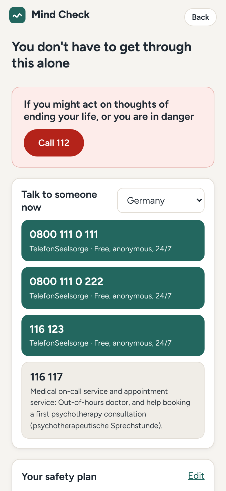
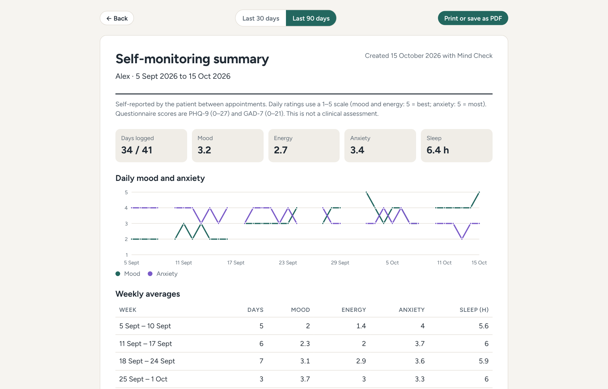
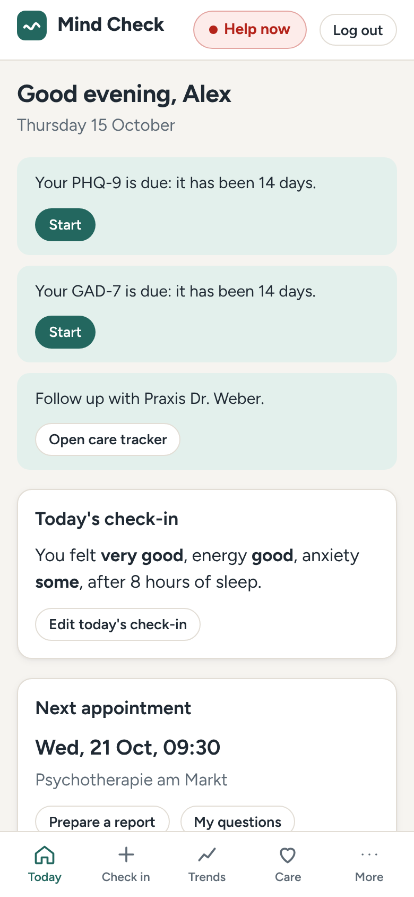
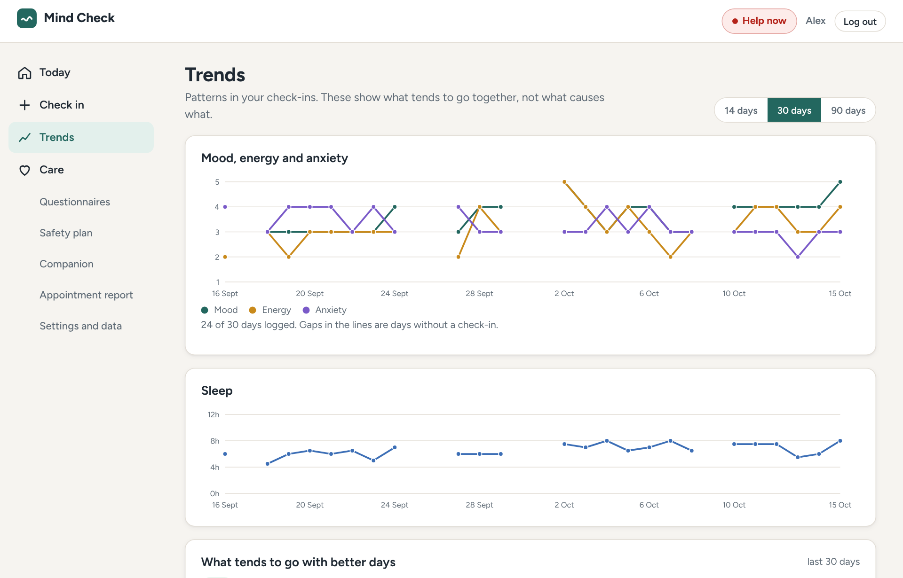

# Mind Check

**A companion for the weeks between asking for help and getting it.**

Mind Check is for people who are waiting for psychotherapy or are between sessions. It helps them do four things well during that time: notice how they are doing, measure it the way clinicians do, keep their search for a therapist moving, and arrive at the first appointment with a clear summary instead of a blurred memory of the last two months. When things get bad, help is always one tap away.



## Why this exists

In Germany, getting from "I need help" to regular psychotherapy usually takes weeks and often months:

- The Federal Chamber of Psychotherapists (BPtK) measured an average of **5.7 weeks to a first consultation** and **about 20 weeks to the start of treatment** ([BPtK waiting-time study 2018](https://www.aerzteblatt.de/news/9875a9a7-5c97-4da5-af4d-88747db71e3c)).
- Its analysis of 2019 billing data found that **about 40% of patients waited three to nine months** after the consultation before treatment began ([Ärzteblatt, March 2021](https://www.aerzteblatt.de/nachrichten/122485/BPtK-warnt-vor-ueberlangen-Wartezeiten-auf-Psychotherapietermine)).
- Health insurers read their data differently and report shorter medians for patients who do get through ([vdek analysis, 2023](https://www.vdek.com/magazin/ausgaben/2023-04/analyse-wartezeiten-psychotherapie.html)). The size of the gap is disputed. That there is one is not.

During that gap most people have no structured way to track their symptoms, a list of practices that only answer the phone for an hour on Tuesdays, and no plan for a bad night. At the first appointment they are asked how the last weeks have been and have to answer from memory.

Mind Check is built for exactly that gap, and only that gap. It is **not** therapy, it does not diagnose, it is not a medical device and it is not an emergency service. It tells people this plainly and sends anyone at risk to people, not to software.

### Who it is for

| User | What they get |
|---|---|
| Someone looking for a therapist or on a waiting list | A daily habit that takes 30 seconds, a care tracker that turns "I should call again" into dated follow-ups, and a safety plan |
| Someone already in therapy | A record between sessions that they can print or save as a PDF and share with their therapist or GP |
| Their clinician (indirectly) | A one-page summary in standard measures: PHQ-9, GAD-7, weekly averages, and only the notes the patient chose to share |

## What it does

| Feature | What it does | Why it matters |
|---|---|---|
| **Daily check-in** | Mood, energy and anxiety on 1–5 scales, hours and quality of sleep, activities (exercise, time outdoors, social contact, work, meditation, alcohol, screens late at night) and a private note. One per day; editable up to 7 days back. | Small enough to keep doing every day. A low mood opens a follow-up screen with next steps instead of a generic "thank you". |
| **PHQ-9 and GAD-7** | Validated questionnaires for depression and anxiety, offered every 14 days, scored on the server with the published severity bands. A change of 5 points (PHQ-9) or 4 points (GAD-7) is shown as meaningful. | These are the measures GPs and therapists already use, so the results mean something to them. |
| **Trends** | Charts over 14, 30 or 90 days, with gaps where no check-in exists. "What tends to go with better days" compares mood on days with and without each activity, and after short and long nights, but only with at least 3 days on each side. | Gives people something to try, while saying clearly that these are patterns, not causes. |
| **Care tracker** | Every practice, GP or counselling service contacted, with status (to contact, contacted, on waiting list, appointment booked, in treatment, no place), phone hours, notes, follow-up dates and appointments. "Log contact today" sets the next follow-up a week later. In Germany it points to the 116 117 appointment service. | The search for a therapist is a job in itself. Due follow-ups appear on the Today screen. |
| **Appointment report** | A printable page (or PDF) for the last 30 or 90 days: daily chart, weekly averages, questionnaire results, the notes marked "include in report", and the user's open questions for the appointment. | Turns weeks of check-ins into something a clinician can read in two minutes. Private notes never appear. |
| **Safety plan** | The Stanley–Brown structure: warning signs, things I can do on my own, people and places that distract me, people I can ask for help, professionals, making my surroundings safer, reasons to live. | The best-supported brief intervention for suicide risk. Writing it on a good day makes it usable on a bad one. |
| **Help now** | Emergency number and crisis lines for Germany, Austria, Switzerland, the UK, or a directory for anywhere else, the user's own safety plan, box breathing and 5-4-3-2-1 grounding. Reachable from every screen and without logging in. | In a crisis nobody should have to look for the number. |
| **Companion (optional)** | An AI chat for low moments, prompted to be brief and warm, never to diagnose or give medication advice. It sees no history unless the user switches that on, and then only summary numbers. Conversations are not stored. | Some people want to put a feeling into words at 2 a.m. The design limits what can go wrong (see below). |
| **Reminders** | A calendar file (.ics) with a daily check-in reminder at the user's chosen time and the questionnaires every two weeks. | Works with any phone calendar, without push infrastructure or another app permission. |
| **Your data** | Download everything as JSON. Delete the account and every record with one confirmation. | GDPR rights that work in practice, not only on paper. |

<table>
<tr>
<td width="62%"></td>
<td width="38%"></td>
</tr>
<tr>
<td></td>
<td></td>
</tr>
</table>



## Safety design

A mental health app's most important behaviour is what it does when someone is at risk. These rules are in code and covered by tests:

1. **Risk language never reaches the language model.** Every companion message is checked first against English and German phrases about suicide and self-harm. A match returns a fixed reply with the user's regional emergency number and crisis lines, and the model is not called at all.
2. **PHQ-9 question 9 is never averaged away.** Any answer above "not at all" to the question about thoughts of being better off dead or of self-harm shows crisis contacts straight away and puts a safety prompt at the top of the Today screen, whatever the total score.
3. **Runs of low days are noticed.** Three of the last five check-ins at mood 2 or lower bring up a prompt to open the safety plan or contact care.
4. **Help does not depend on the server.** The crisis contacts are bundled into the web app, so the Help now page works without an account and even while the API is asleep or offline. A test keeps the app's copy identical to the server's.
5. **No clinical claims.** Bands are the published questionnaire bands, labelled as such. Trends say "tends to go with", never "causes". Every report states that it is self-reported and not a clinical assessment.

## Privacy and security

Mood, anxiety and questionnaire answers are health data, a special category under Article 9 GDPR. The app is built on that assumption.

- **Explicit consent** is required at sign-up and stored with a version and timestamp. Accounts created before version 2 are asked again before they can continue.
- **Access, portability and erasure** (Articles 15, 17 and 20): JSON export of every record and permanent deletion of the account and all its data, confirmed with the password.
- **Data minimisation:** no analytics, no tracking, no third-party scripts; the font is self-hosted. The companion stores nothing and shares no history by default.
- **Logs** record the error type only, never request bodies.
- **Authentication:** passwords of at least 10 characters, hashed with bcrypt (cost 12); login takes the same time and gives the same answer for an unknown email and a wrong password; JSON Web Tokens expire after 7 days and stop working when the account is deleted.
- **Hardening:** Helmet security headers, rate limits on login (20 per 15 minutes) and on the API, a per-user hourly limit on the companion, Zod validation of every request body, a 100 KB body limit, and every query scoped to the signed-in user (tested).

What a real launch would still need, and this project does not claim to have: a data processing agreement with the hosting providers and an EU-region database, a lawyer-reviewed privacy policy, a data protection impact assessment (Article 35), field-level encryption for notes, a clinical safety review of the wording, and, if it ever made diagnostic or treatment claims, assessment under the EU Medical Device Regulation.

## Clinical basis

- **PHQ-9:** Kroenke K, Spitzer RL, Williams JBW. The PHQ-9: validity of a brief depression severity measure. *J Gen Intern Med* 2001;16:606–613. Free to use: "No permission required to reproduce, translate, display or distribute."
- **GAD-7:** Spitzer RL, Kroenke K, Williams JBW, Löwe B. A brief measure for assessing generalized anxiety disorder: the GAD-7. *Arch Intern Med* 2006;166:1092–1097. Same terms.
- **Meaningful change:** 5 points on the PHQ-9 (Löwe B et al. *Med Care* 2004;42:1194–1201) and 4 points on the GAD-7 (Toussaint A et al. *J Affect Disord* 2020;265:395–401).
- **Safety planning:** Stanley B, Brown GK. Safety Planning Intervention: a brief intervention to mitigate suicide risk. *Cogn Behav Pract* 2012;19:256–264; and Stanley B et al., *JAMA Psychiatry* 2018, where safety planning with follow-up calls roughly halved suicidal behaviour over six months after emergency department visits.

## Tech stack

| Layer | Tools |
|---|---|
| Frontend | React 18, React Router 6, Vite; dependency-free SVG charts; print stylesheet for the report |
| Backend | Node.js 22, Express 4, Mongoose 9, Zod |
| Database | MongoDB (Atlas in production) |
| Security | bcrypt, JSON Web Tokens, Helmet, express-rate-limit |
| AI | Any OpenAI-compatible API (OpenRouter by default), optional |
| Tests and CI | Vitest, Supertest, GitHub Actions with a MongoDB 7 service |
| Hosting | Render (API and static site), UptimeRobot on the health check |

## Project structure

```
client/src/
  pages/          Today, CheckIn, Trends, Questionnaire(s), Care, SafetyPlan, HelpNow,
                  Companion, Report, Settings, Landing, Auth, Privacy
  components/     Layout (navigation, consent gate), LineChart and ScoreBars, ui
  lib/            api client, auth context, formatting, .ics calendar export
server/src/
  domain/         Pure logic, no database: questionnaire scoring, insights and prompts,
                  crisis detection, regional crisis resources
  models/         User, DailyCheckIn, Assessment, CareContact, AppointmentQuestion, SafetyPlan
  routes/         auth, me (settings, export, delete), checkins, assessments, care,
                  insights and report, chat
  validation.js   Zod schemas for every request body
server/scripts/   seed-demo.js (demo account), migrate-v1.js (upgrade from version 1)
server/test/      domain tests (no database) and API tests (real MongoDB)
```

## API

All routes are under `/api`. "Auth" means a `Bearer` token from login or registration.

| Method | Path | Auth | Purpose |
|---|---|---|---|
| GET | `/health` | no | API and database status |
| POST | `/auth/register`, `/auth/login` | no | Create an account (consent required) or log in |
| GET, PATCH, DELETE | `/me` | yes | Profile and settings; delete account and all data (password required) |
| GET | `/me/export` | yes | Everything stored about the user, as JSON |
| GET | `/checkins?from&to` | yes | Check-ins in a date range |
| PUT, DELETE | `/checkins/:date` | yes | Create or update the check-in for a day; delete it |
| GET | `/assessments/questionnaires` | no | PHQ-9 and GAD-7 items, options and bands |
| GET, POST | `/assessments` | yes | Results; submit answers (scored on the server, with crisis contacts if item 9 is positive) |
| GET, POST, PATCH, DELETE | `/care/contacts[/:id]` | yes | Care tracker |
| GET, POST, PATCH, DELETE | `/care/questions[/:id]` | yes | Questions for the next appointment |
| GET, PUT | `/care/safety-plan` | yes | Safety plan |
| GET | `/insights?today` | yes | Weekly comparison, patterns, due questionnaires, follow-ups and prompts |
| GET | `/report?days&today` | yes | Data for the appointment report |
| GET | `/resources?region` | no | Emergency number and crisis lines for a region |
| GET, POST | `/chat/status`, `/chat` | yes | Companion availability; send messages |

## Running locally

You need Node.js 20 or newer and MongoDB: a free Atlas cluster, or a local server such as `docker run -p 27017:27017 mongo:7`.

```bash
# 1. API
cd server
cp .env.example .env        # set MONGO_URI and JWT_SECRET; the companion is optional
npm install
npm run seed:demo           # optional: demo@mindcheck.example / demo-password-123
npm run dev                 # http://localhost:5000

# 2. Web app, in a second terminal
cd client
npm install
npm run dev                 # http://localhost:5173 (proxies /api to port 5000)
```

The demo account holds six weeks of synthetic check-ins, questionnaire results, care contacts, questions and a safety plan, dated relative to today. All names and phone numbers in it are made up.

### Tests

```bash
cd server
npm test                                                          # domain tests only
TEST_MONGO_URI=mongodb://127.0.0.1:27017/mindcheck_test npm test  # plus API tests
```

The domain tests cover questionnaire scoring and bands, the item-9 safety flag, meaningful change, due dates, crisis detection in English and German, activity and sleep patterns, low-mood runs and the order of prompts. The API tests run against a real database (which they wipe) and cover consent, login, one check-in per day, validation, separation between users, crisis contacts after a positive item 9, the care tracker, the safety plan, which notes reach the report, the companion's crisis bypass, export, account deletion and the version 1 migration. GitHub Actions runs both, with a MongoDB 7 service, and builds the web app on every push and pull request.

### Environment variables

**server/.env**

| Variable | Required | Purpose |
|---|---|---|
| `MONGO_URI` | yes | MongoDB connection string, including the database name |
| `JWT_SECRET` | yes | Long random string used to sign tokens |
| `CLIENT_URL` | yes in production | Web app origin(s) allowed by CORS, comma-separated |
| `PORT` | no | API port, default 5000 |
| `ENABLE_CHATBOT` | no | `true` to switch the companion on |
| `OPENAI_API_KEY` | with the companion | API key for the OpenAI-compatible endpoint |
| `CHAT_BASE_URL`, `CHAT_MODEL` | no | Endpoint and model; default OpenRouter and `openai/gpt-3.5-turbo` |
| `CHAT_LIMIT_PER_HOUR` | no | Companion messages per user per hour, default 40 |

**client/.env** (production builds only)

| Variable | Purpose |
|---|---|
| `VITE_API_BASE_URL` | API base URL ending in `/api`. Unset in development, where Vite proxies `/api`. |

## Upgrading from version 1

Version 1 stored check-ins as great/good/okay/low with energy and stress on 1–10 and no date. After deploying version 2, run once against the production database:

```bash
cd server
npm run migrate:v1
```

It copies every old check-in into the daily format (last check-in of a day wins, 1–10 values halved onto 1–5) and marks older accounts so they are asked for consent on their next visit. The old collection is left untouched and the script is safe to run twice.

## Deployment on Render

- **API (web service):** root directory `server`, build `npm install`, start `npm start`, with the server variables above. Set `CLIENT_URL` to the static site's URL.
- **Web app (static site):** root directory `client`, build `npm install && npm run build`, publish directory `dist`, `VITE_API_BASE_URL` set to the API URL plus `/api`. Add a rewrite from `/*` to `/index.html` so routes work on refresh.
- **Keep-alive:** an UptimeRobot monitor calls `/api/health` every 5 minutes. That keeps the free Render instance awake, and because the endpoint pings MongoDB it also stops a free Atlas cluster from pausing.

## Background

Version 1 was my final project in full-stack and AI software development training: a mood tracker with articles and a support chat. Version 2 is a rebuild around one clear use case, the time between asking for help and receiving it, with validated measures, a care tracker, an appointment report, a safety plan, explicit consent and data rights, and a test suite that runs against a real database.

## Disclaimer

Mind Check is a portfolio project, not a medical device. It does not diagnose, treat or prevent any condition and is not a substitute for professional care. Questionnaire results are for self-monitoring and for sharing with a professional, not for self-diagnosis. All data shown in this repository and its screenshots is synthetic. **If you are in danger or might act on thoughts of ending your life, call your local emergency number (112 in the EU, 999 in the UK) or a crisis line now.** In Germany the TelefonSeelsorge is free and available day and night on 0800 111 0 111 or 0800 111 0 222.
